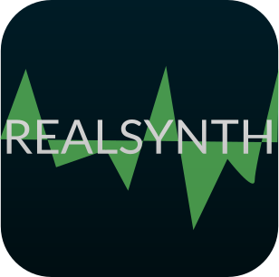

  

<h2>RealSynth Introduction</h2>
RealSynth was a project I was working on for a while now, and I have been stuck on researching the human throat and running into errors for a long time, and now it's early versions are complete. I decided I wouldn't wait and in order to share it with the world to put it here.
 
 
RealSynth creates sound by taking a base wave and also 5 different formants, being F1-F5. F1-F3 is what makes the sound of the letter and syllable/phoneme, while F4 and F5 are the identity of the singer. This was made in PyQt6, so make sure you have that installed while running it. There will be a voicebank attached in the releases folder. The voicebank is a pretty basic one, meaning it should be a great start if you want to begin making your own bank. Please note that English is the only functioning language right now and that others will default to English no matter what the Language box says.
  
<h2>Credit</h2>
<li>EAQ150: Project Lead / Main Developer / Engine Maintenence</li>
<li>Waddle250: DAW Developer / Art</li>
